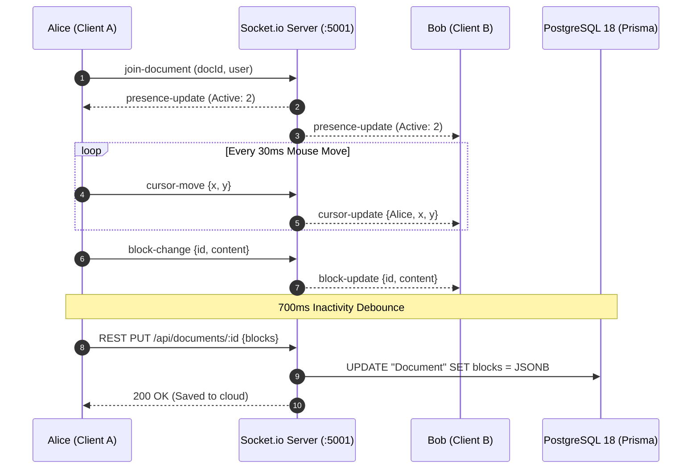

# 🚀 Nexvia Technologies — Full-Stack SWE Internship Deliverables

> **Candidate:** Krish (GitHub: [@KrishDevCrafting](https://github.com/KrishDevCrafting))  
> **Intern ID:** `NEX-INT-2026-2710`  
> **Specialization Track:** Full-Stack Development  
> **Submission Deadline:** November 20, 2026  
> **Core Focus:** Real-Time WebSockets, PostgreSQL 18 & Prisma Mastery, React 19, Micro-Latency Collaboration  

---

## 🏆 Executive Summary

This repository represents the official, production-grade deliverables for the **Nexvia Technologies Full-Stack Engineering Internship**. It consolidates two end-to-end full-stack applications engineered with rigorous modularity, high-throughput WebSockets, robust databases, and zero-compromise security:

🔗 **Live Production Deployments:**  
- **FS-02 (SyncFlow Workspace Client):** [https://nexvia-fullstack-internship-client.vercel.app/](https://nexvia-fullstack-internship-client.vercel.app/)  
- **Official GitHub Repository:** [https://github.com/KrishDevCrafting/nexvia-fullstack-internship](https://github.com/KrishDevCrafting/nexvia-fullstack-internship)  

```
nexvia-fullstack-internship/
├── 📁 Learning Management System with Live Classes/  (FS-03 — EduConnect LMS)
│   ├── server/   ──> Node.js, Express, Socket.io, MongoDB Atlas, JWT
│   └── client/   ──> React 19, Vite, Tailwind CSS, WebRTC Screen Share, AMOLED Theme
│
├── 📁 Real-Time Collaborative Workspace/            (FS-02 — SyncFlow Workspace)
│   ├── server/   ──> Node.js, Express, Socket.io, PostgreSQL 18, Prisma 6 (JSONB)
│   └── client/   ──> React 19, Vite, Tailwind CSS v4, Multi-Cursors, Notion/Figma Stage
│
└── 📄 README.md  ──> Master Architecture & Evaluation Blueprint
```

---

## 📊 Comprehensive Tech Stack Matrix

| Domain | FS-03 (EduConnect LMS) | FS-02 (SyncFlow Workspace) |
| :--- | :--- | :--- |
| **Frontend Framework** | React 19 + Vite 6 | React 19 + Vite 6 |
| **Styling & Design** | Tailwind CSS (AMOLED Pitch Black `#000`) | Tailwind CSS v4 (Sleek Dark Theme) |
| **Backend Runtime** | Node.js (ES Modules) + Express 5 | Node.js (ES Modules) + Express 4 |
| **Primary Database** | **MongoDB Atlas** (Cluster0, Mongoose ODM) | **PostgreSQL 18** (Prisma 6 ORM) |
| **Real-Time Protocol** | Socket.io v4 (Rooms, Chat, Raise-Hand, Radar) | Socket.io v4 (Throttled Live Cursors, Blocks, Canvas) |
| **Specialized Media** | WebRTC `getDisplayMedia`, Video PiP | Export to Markdown (`.md`), Native `JSONB` Trees |
| **Port Allocation** | Backend `:5000` \| Client `:5173` | Backend `:5001` \| Client `:5174` |

---

## 🎓 Project 1: FS-03 — Learning Management System with Live Classes

### 🎯 Key Engineering Highlights:
- **Interactive Multi-Mode Streaming Stage:**
  1. 📊 **Lecture Slide Deck Mode:** High-definition architectural slides with ASCII diagrams, code snippets, and keyboard navigation.
  2. 🖥️ **WebRTC Screen Sharing Mode:** Hardware-accelerated screen capture via `navigator.mediaDevices.getDisplayMedia` with automatic stream cleanup on native browser termination.
  3. 💻 **Live Code Stage:** Real-time syntax-focused engineering view.
- **Micro-Latency Interaction:**
  - ✋ **Raise Hand Broadcast:** Bouncing live banner notification delivered to instructors in <10ms.
  - 🔴 **Dynamic Audience Count:** Server-side `io.sockets.adapter.rooms.get(classId)?.size` calculation eliminating hardcoded spectator counts.
  - 💬 **Live Moderated Chat:** Instant attendee announcements and discussion thread.
- **Student Curriculum & Lifecycle Engine:**
  - Role-based JWT authentication (`req.user.id` extraction).
  - Course catalog with category & level filtering.
  - Progress tracker, module completion badges, and assignment feedback system.
- **AMOLED True-Black Theme:**
  - Standard-compliant dark mode with `#000000` base, `#09090b` surfaces, and zero-FOUC (Flash of Unstyled Content) inline theme bootstrapper.

---

## 🎨 Project 2: FS-02 — Real-Time Collaborative Workspace (Notion/Figma Style)

### 🎯 Key Engineering Highlights:
- **Dual-Mode Document & Canvas Workspace:**
  1. 📄 **Doc View (Notion Style):** Block-level rich editing (`h1`, `h2`, `h3`, `paragraph`, `todo` checklists, `code` blocks, `callout` boxes, `divider` lines) with keyboard ergonomics (<kbd>Enter</kbd> to add block, <kbd>Backspace</kbd> to merge/delete).
  2. 🎨 **Canvas Board (Figma Style):** Coordinate-based spatial whiteboard with draggable sticky notes and architecture cards across 6 vibrant palettes.
- **Figma-Style Live Multi-User Cursors:**
  - Throttled mouse movement (`30ms` / ~33 FPS interval) to optimize packet size and prevent bandwidth saturation.
  - SVG pointer arrows rendered with distinctive user colors and floating name tags.
- **Active Collaborator Presence Bar:**
  - In-memory socket room tracking (`Map<RoomId, Map<SocketId, UserInfo>>`) with glowing presence status rings and disconnect garbage collection.
- **PostgreSQL 18 + Prisma ORM with Native `JSONB`:**
  - Block hierarchies and spatial canvas items are persisted using PostgreSQL native **`JSONB`**, delivering schema flexibility without sacrificing relational integrity or ACID guarantees.
  - Debounced auto-save engine (`700ms`) preventing database write-thrashing during high-speed typing.
- **Export to Markdown (`.md`):**
  - In-browser CommonMark compilation that serializes JSON block structures into downloadable `.md` files with zero server compute.

---

## ⚡ Real-Time Network & WebSockets Architecture



---

## 🚀 Local Development Setup

### Prerequisites:
- Node.js >= 18.0.0
- PostgreSQL 18 (Active on `localhost:5432`)
- MongoDB Atlas account (Configured URI in `.env`)

### 1. Database Setup
```bash
# Set local PostgreSQL password & create database
bash setup_db.sh
```

### 2. Launch Project 1 (EduConnect LMS)
```bash
# Terminal 1: Backend
cd "Learning Management System with Live Classes/educonnect-lms/server"
npm install
npm run dev
# Running on http://localhost:5000

# Terminal 2: Frontend
cd "Learning Management System with Live Classes/educonnect-lms/client"
npm install
npm run dev
# Running on http://localhost:5173
```

### 3. Launch Project 2 (SyncFlow Workspace)
```bash
# Terminal 3: Backend
cd "Real-Time Collaborative Workspace/server"
npm install
npx prisma db push
npm run dev
# Running on http://localhost:5001

# Terminal 4: Frontend
cd "Real-Time Collaborative Workspace/client"
npm install
npm run dev
# Running on http://localhost:5174
```

---

## 🎤 10-Minute Final Presentation Blueprint

*Designed for the Nexvia Internship Evaluation Panel:*

| Time | Slide / Topic | Key Points to Present |
| :---: | :--- | :--- |
| **0:00 - 1:30** | **Problem Statement & Scope** | Addressing high-latency collaboration and fractured virtual learning tools through real-time event-driven architectures. |
| **1:30 - 4:00** | **System Architecture & Dual DB Strategy** | Comparing MongoDB Atlas (curriculum tree) vs. PostgreSQL 18 + Prisma (native JSONB for Notion/Figma block persistence). |
| **4:00 - 6:30** | **Real-Time Engine & Live Cursors Demo** | Demonstrating 30ms throttled Socket.io cursors, room partitioning, presence avatars, and WebRTC screen sharing. |
| **6:30 - 8:30** | **Key Technical Challenges & Solutions** | 1. Mitigating React ref race conditions during conditional WebRTC mounting. <br>2. Linux Peer vs. TCP password authentication in PostgreSQL. <br>3. Debounced auto-save preventing DB thrashing. |
| **8:30 - 10:00**| **Results, Scalability & Reflection** | Horizontal scaling via `@socket.io/redis-adapter`, test metrics, and personal growth as a full-stack engineer. |

---

## 🌟 Intern Reflection & Ownership

> *"This internship journey with Nexvia Technologies transformed my theoretical full-stack foundation into enterprise-level engineering discipline. By owning both the Learning Management System and the Real-Time Collaborative Workspace from scratch, I mastered the delicate balance between low-latency WebSockets and durable database persistence. Resolving complex state synchronization across distributed browser sessions and architecting PostgreSQL native JSONB schemas gave me immense confidence in building production-ready, distributed full-stack systems."*  
> — **Krish (KrishDevCrafting)**

---

## 📄 License & Attribution
Developed and submitted for the **Nexvia Technologies Full-Stack Internship (Batch of 2026)**. All rights reserved by Krish.

